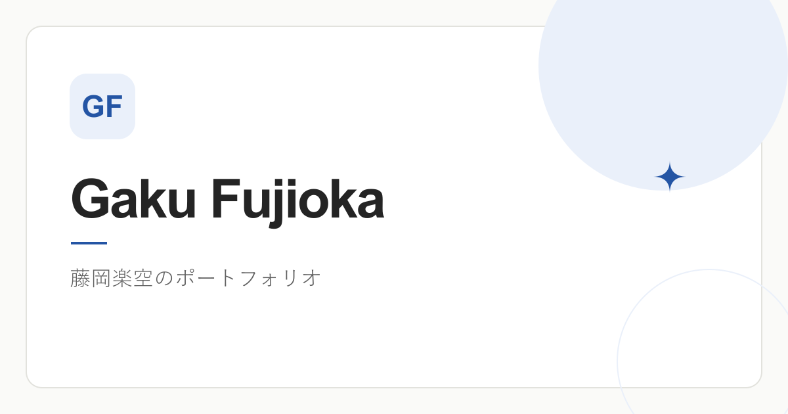

<div align="center">
  <a href="https://gaku-fujioka.vercel.app/">
    
  </a>

  <h1>Personal Site</h1>
  <p>つくったもの、学んだこと、日々の記録。</p>
  <p>電気通信大学で情報・セキュリティを学ぶ、藤岡楽空の個人サイトです。</p>

  <p>
    <a href="https://gaku-fujioka.vercel.app/">Webサイトを見る</a> ·
    <a href="https://github.com/Gaku-Fujioka">GitHub</a> ·
    <a href="https://x.com/fujio_dayo">X</a>
  </p>

  <p>
    
    
    
    
  </p>
</div>

## このサイトについて

Web開発に取り組む中で制作した作品と、その背景や学びをまとめています。フロントエンドの基礎を学び直しながら、自分でも仕組みを理解して改善していくためのサイトです。

| ページ | 内容 |
| --- | --- |
| [Home](https://gaku-fujioka.vercel.app/) | 自己紹介・代表作品・最新のJournal |
| [About](https://gaku-fujioka.vercel.app/about/) | これまでの経験・サークル活動・使用技術 |
| [Projects](https://gaku-fujioka.vercel.app/projects/) | 制作の背景・主な機能・担当内容・画面紹介 |
| [Journal](https://gaku-fujioka.vercel.app/journal/) | 日々のメモや出かけた記録。現在は準備中 |

## 掲載している作品

| 作品 | 概要 | 制作形態 |
| --- | --- | --- |
| [ひといき](https://gaku-fujioka.vercel.app/projects/#hitoiki) | AIとの作業ログから負担の目安を推定し、作業の区切りで休憩を提案するChrome・VS Code拡張 | JPHACKS 2026・チーム開発 |
| [いえぴた！](https://gaku-fujioka.vercel.app/projects/#iepita) | 暮らし方の診断とスワイプで、自分に合う空き家を探すWebアプリのプロトタイプ | 2人チーム・企画から完成まで約2か月半 |
| [いこポケ](https://gaku-fujioka.vercel.app/projects/#ikopoke) | 行きたい場所の共有から、おでかけの計画・記録までをまとめるWebアプリ | 個人開発・非公開・開発中 |

各作品の技術構成と担当内容は、サイトのProjectsページで紹介しています。いこポケは家族や親しい人向けのため、アプリとソースコードの利用リンクは掲載していません。

## 技術構成

| 用途 | 技術 |
| --- | --- |
| サイト生成 | Astro |
| データ・コンポーネント | TypeScript / Astroコンポーネント |
| スタイリング | CSS |
| 記事 | Astro Content Collections / Markdown |
| 画像処理 | sharp / WebP |
| 記事編集 | Decap CMS / GitHub OAuth（ローカル編集にも対応） |
| ホスティング | Vercel / GitHub連携 |

### 実装で工夫していること

- プロフィールや作品情報をデータファイルにまとめ、表示するコンポーネントと分離。
- スマートフォンからPCまで対応し、スキップリンク・フォーカス表示・画像の代替テキストを用意。
- プロフィール写真と作品画面をWebPに変換し、画像の寸法を明示。
- 公開ページを静的HTMLとして生成し、技術アイコンもリポジトリ内のSVGを使用。
- 記事の下書きと公開用データを分け、記事内で参照する画像だけを公開用に生成。

## ローカルで動かす

**必要な環境：Node.js 22.12.0以上 / pnpm**

```bash
git clone https://github.com/Gaku-Fujioka/personal-site.git
cd personal-site
pnpm install --frozen-lockfile
pnpm astro dev --background
```

[http://localhost:4321](http://localhost:4321) を開きます。初期状態は記事0件で動作し、環境変数や外部サービスの認証情報は不要です。

| コマンド | 用途 |
| --- | --- |
| `pnpm astro dev status` | 開発サーバーの状態確認 |
| `pnpm astro dev logs` | 開発サーバーのログ確認 |
| `pnpm astro dev stop` | 開発サーバーの停止 |
| `pnpm build` | `dist/` に静的サイトを生成 |
| `pnpm preview` | ビルド済みサイトを確認 |
| `pnpm test` | 記事データ・画像処理・未公開データ分離・CMS認証のテスト |
| `pnpm check` | ビルド後のHTML・見出し・画像altと寸法・内部リンクを検証 |

## ファイル構成

```text
src/
├── components/       共通UI・作品カード・記事表示
├── data/             プロフィール・作品・アイコンの対応表
├── layouts/          共通レイアウト・メタデータ
├── pages/            Home / About / Projects / Journal / 管理画面
├── assets/           画像の原本・共有画像の編集元
├── lib/              記事の日付表示・並び順など
└── styles/           共通CSS
public/               配信用画像・アイコン・CMSのスクリプト
api/                  Vercel Functions（CMSのGitHub認証）
server/               OAuthのstate・PKCE・本人確認
scripts/              画像最適化・記事の準備・検証
tests/                記事処理のテスト
docs/                 運用手順・仕様書
```

プロフィールやSNSは [src/data/profile.ts](src/data/profile.ts)、作品の説明や画像は [src/data/projects.ts](src/data/projects.ts) で編集できます。記事管理・画像の更新・環境変数は [運用ガイド](docs/maintenance.md) にまとめています。

## 公開・更新

**公開URL：[gaku-fujioka.vercel.app](https://gaku-fujioka.vercel.app/)**

`main`へのpushでVercelが自動デプロイします。ビルド時に`pnpm build`と`pnpm check`を実行し、`dist/`を配信します。canonicalとOG画像のURLは、Vercelの本番URLから生成します。

Journalは記事0件で公開しています。非公開の記事保存先・GitHub認証・記事更新からの自動ビルドを接続しています。接続設定と記事の書き方は [Journalの初回接続](docs/journal-setup.md) を参照してください。

## クレジット

- 技術アイコン：[Skill Icons](https://github.com/tandpfun/skill-icons)（[MIT License](public/icons/skills/LICENSE.txt)）
- SNSロゴ：[Shields.io](https://shields.io/)経由で取得し、サイト内にSVGとして保存
